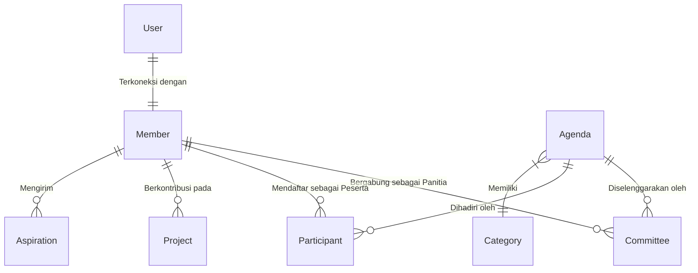

# Arsitektur Database

Sistem HIMATIKA dibangun di atas basis data NoSQL MongoDB dengan memanfaatkan ODM Mongoose. Meskipun NoSQL bersifat dinamis, ekosistem ini secara ketat menegakkan skema data melalui kapabilitas referensi populasi.

## Struktur Entitas Utama (Entity-Relationship)

## Mekanisme Atomic Updates & Constraints

Untuk menjaga konsistensi data dari risiko _race condition_ (seperti registrasi ganda bersamaan), kami mengandalkan **Unique Compound Index** di level Database:

- `ParticipantModel` memiliki Index unik pada kombinasi `agendaId` dan `member` (atau `guest`).
- `CommitteeModel` memiliki Index unik pada kombinasi `agendaId` dan `member`.

Dengan struktur index ini, operasi `findOneAndUpdate` di server Nitro (API) kebal dari insiden pendaftaran ganda akibat keterlambatan respons I/O memory.

## Aturan Populasi Mongoose

Hindari operasi berulang (N+1 query). Manfaatkan `autopopulate` atau deklarasi `populate()` di level API controller saat data anggota diperlukan.
